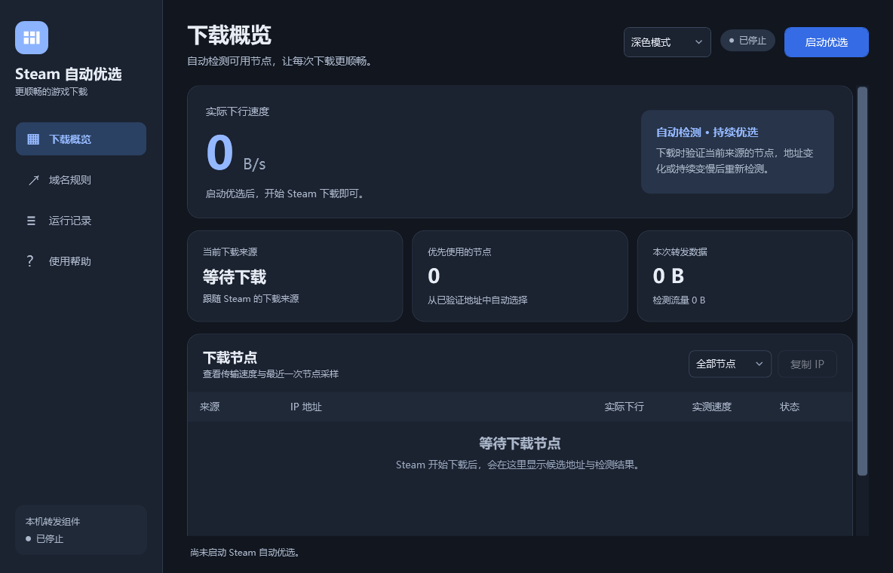

# Steam 自动优选

一个用于 Windows 的 Steam HTTP 下载域名管理与 CDN 节点自动优选工具。提供原生 WPF 界面、下载节点状态、域名编辑、运行记录及深色模式。

当前版本：**2.1.0**。支持 Windows 10 / 11 x64，需要 .NET Framework 4.8。发布包内置 Node.js，无需单独安装 Node.js 即可运行。



## 下载与启动

从本仓库的 **Releases** 下载 `SteamSmart-2.1.0-windows-x64.zip` 并解压，双击 `Steam自动优选.exe`。Windows 会请求管理员权限，用于设置和恢复下载域名的 hosts 映射。

窗口打开后自动启动优选；随后在 Steam 中开始下载。首次运行会在应用旁生成 `support/SteamSmart` 数据目录。

源码目录中的 `release/` 只保留发布说明；安装包通过 Releases 提供。

## 使用

- **下载概览**：显示总传输速度、当前来源及节点状态。工具收到真实下载请求后检测对应来源的候选节点，换游戏或来源变化后重新验证。
- **域名规则**：添加、编辑、删除 Steam HTTP 下载域名，并选择对应 CDN 来源。保存前会校验规则。
- **运行记录**：查看启动、节点检测、来源变化和恢复记录。
- **外观**：右上角可切换深色、浅色或跟随系统；选择立即生效并自动保存。
- **停止优选**：停止转发并恢复设置，保留窗口以便再次启动。
- **关闭窗口**：等待停止和恢复完成后退出。最小化会收起到托盘，继续运行。

详细说明见 [使用说明](docs/使用说明.txt)。另保留 [2.0 版图文说明](docs/Steam自动优选2.0使用说明.docx)，其中基础操作仍适用；2.1 新增外观切换。

## 支持范围

目前支持默认配置所列的 **Steam HTTP 下载来源**，不处理 CS 对战连接。下载速度仍取决于宽带、网络线路、CDN、服务器及磁盘，不能保证一定提速。

“下载地址”保留请求的原域名、文件路径和授权，向该来源的节点请求数据；“跳转入口”按规则跳转到该来源的下载域名。本工具无法把任意浏览器、迅雷、WeGame 或 HTTPS 下载交给 Steam CDN。

默认监听 `127.0.0.19:80`；如其他程序占用该端口，需要先处理冲突。运行时无需同时启动原 UsbEAm 助手的 Steam 服务。

## 从源码构建

构建环境：Windows x64、.NET Framework 4.8、Node.js 24.x，以及可执行 PowerShell 脚本的终端。

```powershell
git clone https://github.com/panchen00001-blip/steam-smart.git
cd steam-smart
& .\src\build.ps1 -NodePath (Get-Command node.exe).Source
```

输出为 `dist/Steam自动优选.exe`，包含 `engine/` 下的运行引擎。可用 `-EngineDirectory`、`-NodePath`、`-OutputDirectory` 指定路径。构建期间不会启动下载转发或修改 hosts。

### 界面验证

在 Windows PowerShell 5.1 的 STA 模式下运行：

```powershell
powershell.exe -NoProfile -STA -ExecutionPolicy Bypass -File .\tests\test-theme-ui.ps1
```

此验证使用隔离目录，检查主题切换、偏好保存、表格编辑和页面布局，不启动真实下载转发。其他控制器与生命周期测试的源码位于 `tests/`，使用独立配置及 hosts fixture。

## 目录

```text
src/          WPF 窗口、生命周期控制、主题管理及构建脚本
engine/       HTTP 转发、节点验证、hosts 管理和默认规则
tests/        界面和生命周期验证源码
docs/         使用说明与界面截图
third-party/  第三方授权与来源说明
release/      版本说明；安装包附在 GitHub Releases
```

## 本地数据与来源

应用运行后生成的配置、节点历史、hosts 恢复记录和外观偏好保留在本机，不在源码仓库中提交。签名下载链接与授权只用于内存中的转发和测速，不写入节点历史。

默认 CDN 规则参考 [UsbEAm 规则源](https://www.dogfight360.com/Usbeam/dl2v6_v2.ini)。本仓库不包含 UsbEAm 程序文件，也不代表 Steam、Valve、UsbEAm 或任何 CDN 提供商。

发布 EXE 包含 Node.js v24.22.1，其完整授权见 [NODE-LICENSE.txt](third-party/NODE-LICENSE.txt)。参见 [第三方说明](third-party/THIRD-PARTY-NOTICES.md)。本项目自身暂未指定开源许可证。
